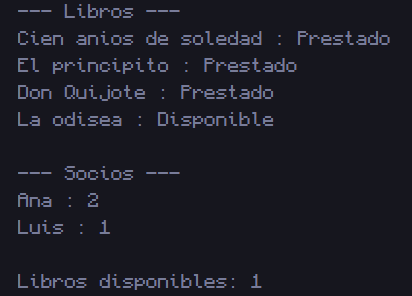

# 5. Biblioteca

## 📝 Resumen

Programa que modela una biblioteca con dos clases: **`Libro`** (`titulo`, `autor`, `disponible`) y **`Socio`** (`nombre`, `librosPrestados`). En `Main` se crean **4 libros** y **2 socios**. El primer socio presta 2 libros y el segundo presta 1: cada préstamo pone `disponible = false` en el libro y aumenta `librosPrestados` del socio.

Al final se imprime cada libro con el formato `titulo : Disponible` o `titulo : Prestado`, cada socio con el formato `nombre : librosPrestados` y cuántos libros quedan disponibles.

**Conceptos que practica:** **interacción entre dos clases**, constructores, métodos (`prestar`), arreglo de objetos, operador ternario y contadores.

## 📁 Archivos

| Archivo | Descripción |
|---|---|
| [`Libro.java`](Libro.java) | Clase con `titulo`, `autor` y `disponible` (inicia en `true`). |
| [`Socio.java`](Socio.java) | Clase con `nombre`, `librosPrestados` y el método `prestar(Libro)`. |
| [`Main5.java`](Main5.java) | Crea libros y socios, registra los préstamos e imprime el resumen. |
| [`Captura/CapturaBiblioteca.png`](Captura/CapturaBiblioteca.png) | Captura de la ejecución. |

## ▶️ Cómo ejecutar

Requiere tener instalado el **JDK 8 o superior**.

```bash
# 1. Ubícate en esta carpeta (desde la raíz del repositorio)
cd "Codigos/Biblioteca"

# 2. Compila todas las clases (Libro, Socio y Main5)
javac *.java

# 3. Ejecuta el programa principal
java Main5
```

> Si usas un IDE (IntelliJ, NetBeans, Eclipse, VS Code), abre esta carpeta y ejecuta `Main5.java`.

## 🖥️ Salida esperada

```text
--- Libros ---
Cien anios de soledad : Prestado
El principito : Prestado
Don Quijote : Prestado
La odisea : Disponible

--- Socios ---
Ana : 2
Luis : 1

Libros disponibles: 1
```

## 🖼️ Captura



---
⬅️ [Volver al README principal](../../README.md)
