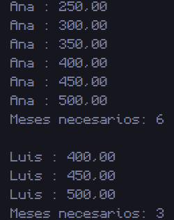

# 4. Cuenta de ahorro

## 📝 Resumen

Programa que modela cuentas de ahorro con la clase **`Cuenta`** (atributos `titular` y `saldo`). En `Main` se crean **2 cuentas**: una con saldo inicial de **200** y otra de **350**. Con un ciclo **`while`** se deposita **50 por mes** en cada cuenta hasta que el saldo llega a **500**, imprimiendo cada mes con el formato `titular : saldo`. Al final se muestra cuántos meses necesitó cada cuenta: **6** y **3**.

**Conceptos que practica:** clases y objetos, constructor, ciclo `while`, contadores y formato de salida con `printf`.

## 📁 Archivos

| Archivo | Descripción |
|---|---|
| [`Cuenta.java`](Cuenta.java) | Clase con los atributos `titular` y `saldo`. |
| [`Main4.java`](Main4.java) | Crea las cuentas, simula los depósitos mensuales y cuenta los meses. |
| [`Captura/CapturaCuentaDeAhorro.png`](Captura/CapturaCuentaDeAhorro.png) | Captura de la ejecución. |

## ▶️ Cómo ejecutar

Requiere tener instalado el **JDK 8 o superior**.

```bash
# 1. Ubícate en esta carpeta (desde la raíz del repositorio)
cd "Codigos/Cuenta de ahorro"

# 2. Compila todas las clases
javac *.java

# 3. Ejecuta el programa principal
java Main4
```

> Si usas un IDE (IntelliJ, NetBeans, Eclipse, VS Code), abre esta carpeta y ejecuta `Main4.java`.

## 🖥️ Salida esperada

```text
Ana : 250.00
Ana : 300.00
Ana : 350.00
Ana : 400.00
Ana : 450.00
Ana : 500.00
Meses necesarios: 6

Luis : 400.00
Luis : 450.00
Luis : 500.00
Meses necesarios: 3
```

> Ana parte de 200 y necesita 6 meses; Luis parte de 350 y necesita 3 meses.

## 🖼️ Captura



---
⬅️ [Volver al README principal](../../README.md)
