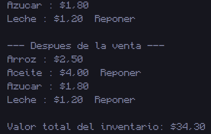

# 2. Inventario de una tienda

## 📝 Resumen

Programa que modela el inventario de una tienda con la clase **`Producto`** (atributos `nombre`, `precio` y `stock`). En `Main` se crean **4 productos** y se imprimen con el formato `nombre : precio`. Luego se **simula la venta de 3 unidades** de dos de ellos y se vuelve a mostrar el inventario, añadiendo la palabra **"Reponer"** junto a cada producto que tenga **menos de 5 unidades** en stock. Al final se imprime el **valor total del inventario** (suma de `precio × stock`).

**Conceptos que practica:** clases y objetos, constructor, métodos que modifican el estado del objeto (`vender`), arreglo de objetos, condicionales y acumuladores.

## 📁 Archivos

| Archivo | Descripción |
|---|---|
| [`Producto.java`](Producto.java) | Clase con los atributos y los métodos `vender(int cantidad)` y `mostrar()`. |
| [`Main2.java`](Main2.java) | Crea los productos, simula las ventas y calcula el valor total del inventario. |
| [`Captura/CapturaInventarioDeUnaTienda.png`](Captura/CapturaInventarioDeUnaTienda.png) | Captura de la ejecución. |

## ▶️ Cómo ejecutar

Requiere tener instalado el **JDK 8 o superior**.

```bash
# 1. Ubícate en esta carpeta (desde la raíz del repositorio)
cd "Codigos/Inventario de una tienda"

# 2. Compila todas las clases
javac *.java

# 3. Ejecuta el programa principal
java Main2
```

> Si usas un IDE (IntelliJ, NetBeans, Eclipse, VS Code), abre esta carpeta y ejecuta `Main2.java`.

## 🖥️ Salida esperada

```text
--- Productos iniciales ---
Arroz : $2.50
Aceite : $4.00  Reponer
Azucar : $1.80
Leche : $1.20  Reponer

--- Despues de la venta ---
Arroz : $2.50
Aceite : $4.00  Reponer
Azucar : $1.80
Leche : $1.20  Reponer

Valor total del inventario: $34.30
```

> Las ventas son de 3 unidades de **Arroz** (10 → 7) y de **Aceite** (3 → 0). Los productos con menos de 5 unidades (Aceite y Leche) muestran "Reponer".

## 🖼️ Captura



---
⬅️ [Volver al README principal](../../README.md)
