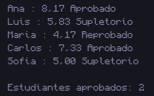

# 1. Notas del curso

## 📝 Resumen

Programa que modela estudiantes con la clase **`Estudiante`** (atributos `nombre`, `nota1`, `nota2`, `nota3` y `promedio`). En `Main` se crean **5 instancias**, se calcula el promedio de cada una y se imprime una debajo de otra con el formato `nombre : promedio` seguido del estado:

| Promedio | Estado |
|---|---|
| 7 o más | **Aprobado** |
| de 5 a 6.99 | **Supletorio** |
| menos de 5 | **Reprobado** |

Al final se imprime cuántos estudiantes aprobaron.

**Conceptos que practica:** clases y objetos, constructor, métodos, arreglo de objetos, `if / else if / else` y `for-each`.

## 📁 Archivos

| Archivo | Descripción |
|---|---|
| [`Estudiante.java`](Estudiante.java) | Clase con los atributos, el método `calcularPromedio()` y el método `estado()`. |
| [`Main.java`](Main.java) | Crea los 5 estudiantes, imprime los resultados y cuenta los aprobados. |
| [`Captura/CapturaNotasDelCurso.png`](Captura/CapturaNotasDelCurso.png) | Captura de la ejecución. |

## ▶️ Cómo ejecutar

Requiere tener instalado el **JDK 8 o superior**.

```bash
# 1. Ubícate en esta carpeta (desde la raíz del repositorio)
cd "Codigos/Notas del curso"

# 2. Compila todas las clases
javac *.java

# 3. Ejecuta el programa principal
java Main
```

> Si usas un IDE (IntelliJ, NetBeans, Eclipse, VS Code), abre esta carpeta y ejecuta `Main.java`.

## 🖥️ Salida esperada

```text
Ana : 8.17 Aprobado
Luis : 5.83 Supletorio
Maria : 4.17 Reprobado
Carlos : 7.33 Aprobado
Sofia : 5.00 Supletorio

Estudiantes aprobados: 2
```

## 🖼️ Captura



---
⬅️ [Volver al README principal](../../README.md)
