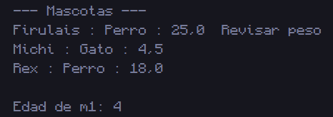

# 3. Veterinaria

## 📝 Resumen

Programa que modela mascotas con la clase **`Mascota`** (atributos `nombre`, `especie`, `edad` y `peso`). En `Main` se crean **3 mascotas** y se imprimen con el formato `nombre : especie : peso`, mostrando **"Revisar peso"** si pesan **más de 20 kg**.

Después se escribe `Mascota m4 = m1;`, se suma 1 a `m4.edad` y se imprime `m1.edad`. El código incluye un comentario que explica por qué `m1.edad` cambió: en Java los objetos se manejan **por referencia**, así que `m4` **no es una copia** de `m1`, sino otra variable que apunta al **mismo objeto** en memoria.

**Conceptos que practica:** clases y objetos, constructor, métodos, condicionales y **referencias a objetos** (aliasing).

## 📁 Archivos

| Archivo | Descripción |
|---|---|
| [`Mascota.java`](Mascota.java) | Clase con los atributos y el método `mostrar()`. |
| [`Main3.java`](Main3.java) | Crea las mascotas, las imprime y demuestra el efecto de `Mascota m4 = m1;`. |
| [`Captura/CapturaVeterinaria.png`](Captura/CapturaVeterinaria.png) | Captura de la ejecución. |

## ▶️ Cómo ejecutar

Requiere tener instalado el **JDK 8 o superior**.

```bash
# 1. Ubícate en esta carpeta (desde la raíz del repositorio)
cd "Codigos/Veterinaria"

# 2. Compila todas las clases
javac *.java

# 3. Ejecuta el programa principal
java Main3
```

> Si usas un IDE (IntelliJ, NetBeans, Eclipse, VS Code), abre esta carpeta y ejecuta `Main3.java`.

## 🖥️ Salida esperada

```text
--- Mascotas ---
Firulais : Perro : 25.0  Revisar peso
Michi : Gato : 4.5
Rex : Perro : 18.0

Edad de m1: 4
```

> `m1.edad` pasa de 3 a 4 aunque solo se modificó `m4.edad`, porque ambas variables referencian el mismo objeto.

## 🖼️ Captura



---
⬅️ [Volver al README principal](../../README.md)
